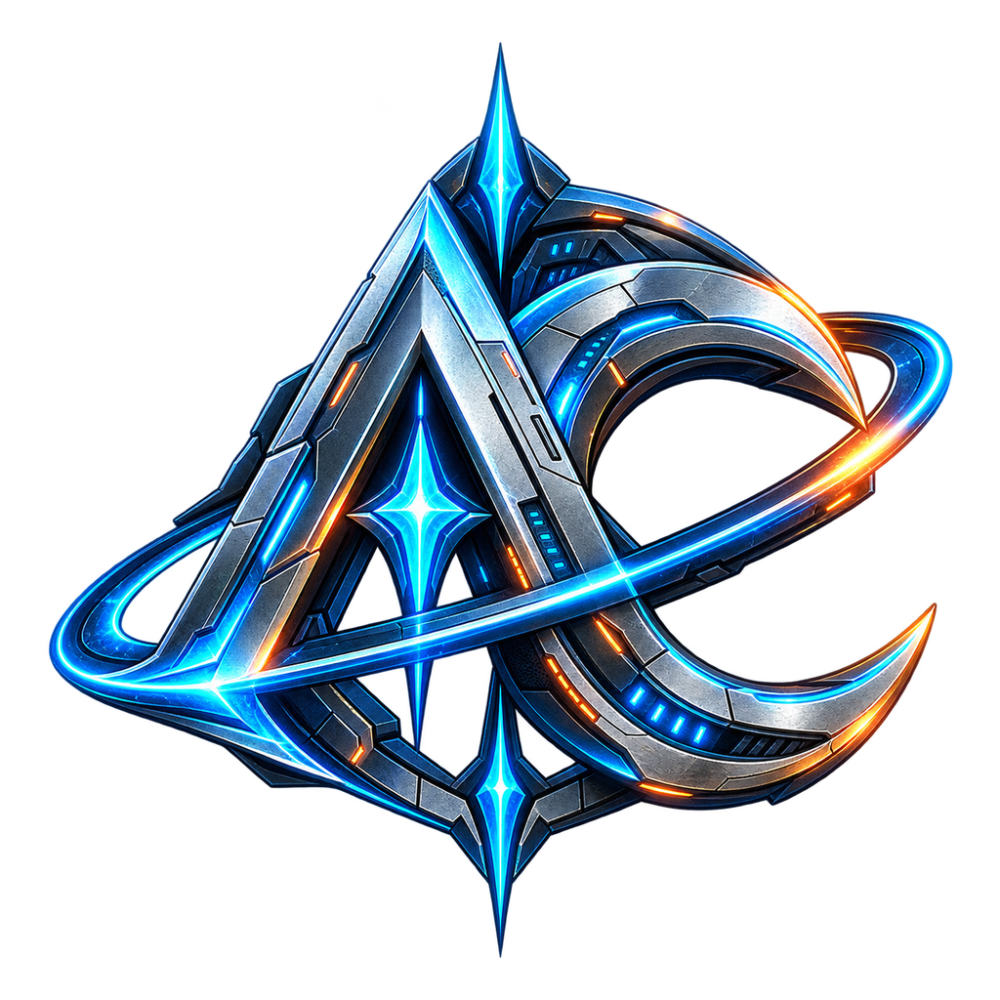

<p align="center">
  
</p>

<h1 align="center">Nexforge AION 2 Companion</h1>

<p align="center">
  Tactical desktop companion for AION 2.<br>
  <strong>UNDER FORGE // ACTIVE DEVELOPMENT</strong>
</p>

## Overview

Nexforge AION 2 Companion is a Windows desktop application that turns locally
captured game traffic into useful combat and exploration tools. Its goal is to
keep the meter, encounter history, overlays, map assistance and collection
tools in one application.

The project is not release-ready yet. Interfaces, parsers and data formats can
still change between development builds.

## Current modules

- Live DPS meter with a compact in-game overlay
- Persistent combat history, player breakdowns and timelines
- Boss assistant and timer overlay foundation
- Map helper with pet locations and collection filters
- Class and skill data integration
- Local settings, overlay placement and tray behaviour
- Packet capture diagnostics for development and troubleshooting

## Requirements

- Windows 10 or Windows 11
- [.NET 9 SDK](https://dotnet.microsoft.com/download/dotnet/9.0) for source builds
- Npcap for live packet capture
- Administrator privileges for global game input hooks used by the map helper

The map helper is designed around borderless fullscreen. Other display modes
may not align or react reliably.

## Building

```powershell
dotnet restore
dotnet build "AION 2 Companion.csproj" -c Release
```

Private Nexforge data packs and their master key are intentionally excluded
from the repository. Maintainer builds load the key from
`Private/NfgMaster.key` or the `NEXFORGE_NFG_MASTER_KEY` environment variable.
The key is embedded only into the resulting official build.

## Releases and updates

The project includes a branded per-user Windows installer, an in-app changelog
and a GitHub Release updater with mandatory SHA-256 verification. Maintainer
instructions are documented in
[DOCS/RELEASES_UPDATER_INSTALLER.md](DOCS/RELEASES_UPDATER_INSTALLER.md).

## Data and privacy

- Combat history and settings are stored locally.
- The capture pipeline is limited and buffered to avoid unbounded disk growth.
- Raw research captures, private data packs, build keys and internal tools are
  excluded from Git.

## Project status

This repository currently represents a development build. Public downloadable
releases will be added after the capture pipeline, parsers and overlays are
ready for wider testing.

## License and attribution

The project source is distributed under the license in [LICENSE](LICENSE).
Required Nexforge attribution and third-party content notes are documented in
[NOTICE](NOTICE).

AION 2 and related game assets belong to their respective owners. This is an
independent community project and is not affiliated with or endorsed by the
game's publisher or developer.
