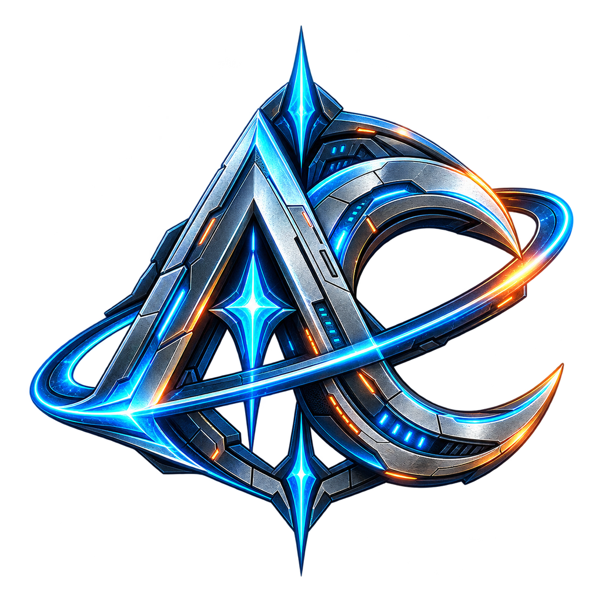
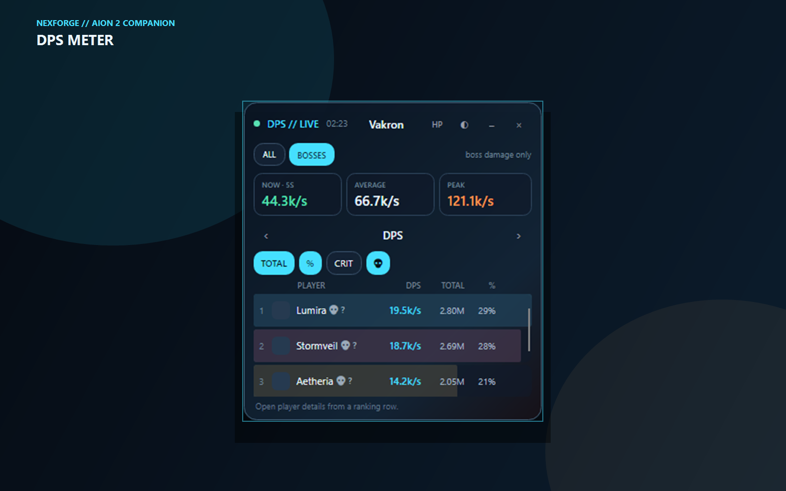
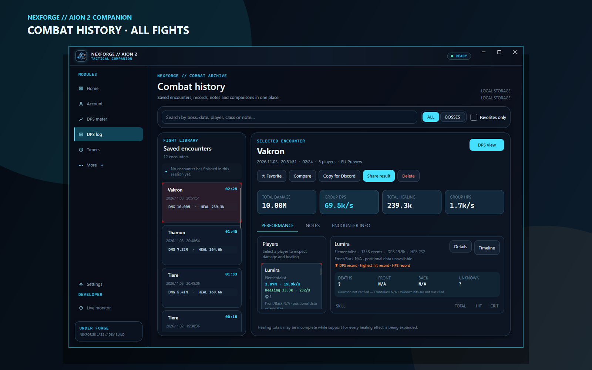
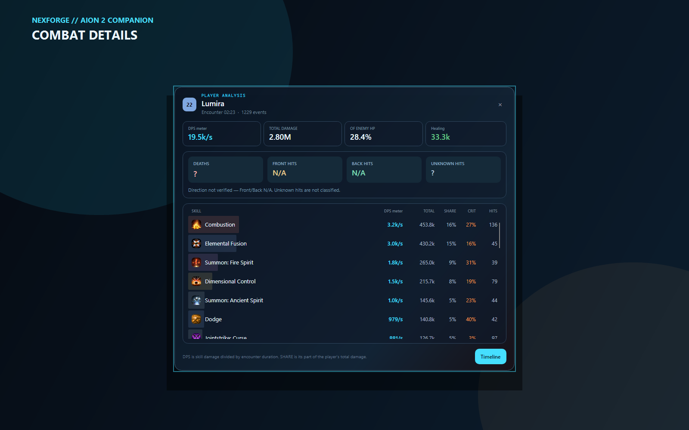
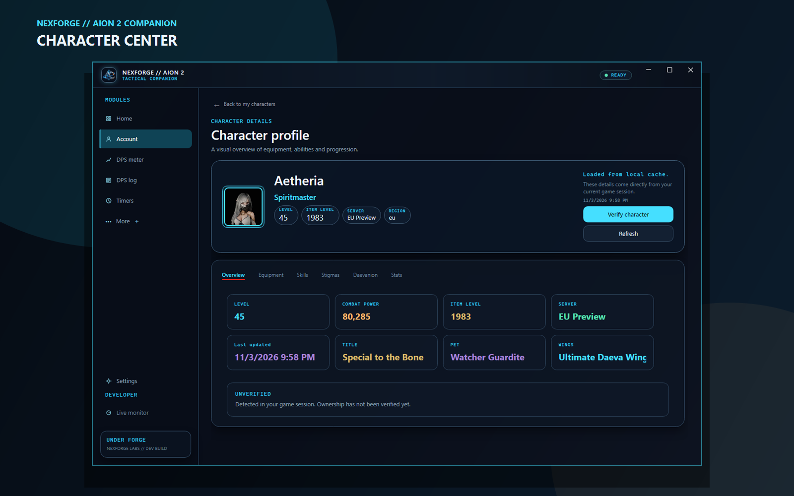
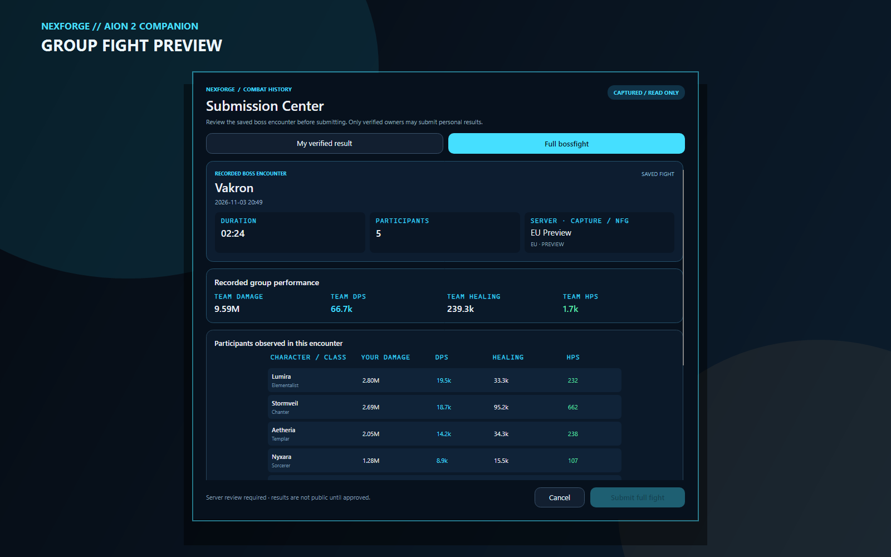

<p align="center">
  
</p>

<h1 align="center">AION 2 Companion</h1>

<p align="center">
  <strong>More than a DPS meter.</strong><br />
  Track your fights. Explore your performance. Make every pull count.
</p>

<p align="center">
  A Windows desktop companion for AION 2, developed by <strong>Nexforge Studios</strong>.
</p>

<p align="center">
  <a href="https://github.com/Alazuriel/Aion2_Companion/releases/latest"><strong>Download Companion</strong></a>
  &nbsp;·&nbsp;
  <a href="https://companion.nexforge.hu/"><strong>Official Website</strong></a>
  &nbsp;·&nbsp;
  <a href="https://discord.gg/PAzmRc4Zs9"><strong>Join our Discord</strong></a>
  &nbsp;·&nbsp;
  <a href="https://github.com/Alazuriel/Aion2_Companion/releases"><strong>Release Notes</strong></a>
</p>

<p align="center">
  
  
  
</p>

---

## One game. More insight.

A boss dies. The damage meter stops. But the fight has more to tell you.

**AION 2 Companion** brings live DPS and HPS tracking, detailed combat history, character tools, customizable overlays, and exploration helpers together in one place. Whether you're testing a build, comparing runs with your party, or checking where your damage came from, Companion is built to make the information easier to find and understand.

This is an **independent community project**, with public downloads available and ongoing improvements driven by development and player feedback.

> **Development notice:** Companion is under active development, and some features remain limited or experimental. **Phaseward is currently not reliable as a boss-mechanics assistant.** See [Current limitations](#current-limitations) before relying on a feature in-game.

## Everything you need for your next run

| Feature | What you can do |
| :-- | :-- |
| **Live DPS / HPS Meter** | Track damage and healing performance through a compact, adjustable overlay. |
| **Combat History** | Browse saved encounters, search fights, review participant breakdowns, skill contributions, and timelines. |
| **Combat Details** | See how individual skills contributed to a recorded fight and compare player-level results. |
| **Overlay Studio** | Customize supported HUD elements, including their positioning, visibility, size, and opacity; manage layout presets. |
| **Character Center** | Explore available character information and account-linked character features. Online details depend on connected services. |
| **Leaderboards & Group Submissions** | Browse rankings, review complete party performance and submit eligible group fight results with recorded damage, DPS, healing and HPS. |
| **Map Helper & Pet Farm** | Use map and collection-oriented tools designed for exploring AION 2. |
| **Diagnostics & Support** | Review available diagnostic information and decide what to export or share when seeking help. |
| **Phaseward — in development** | A boss-mechanics project included in public builds but **not currently dependable for encounter warnings**. |

## See Companion in action

**Screenshots use demonstration data.** Names, character statistics, encounter records and rankings in these UI previews are examples, not verified live results. The interface may vary with application updates.

### Live DPS Meter — see the fight as it happens

Watch your party's recorded damage and healing metrics with an overlay designed to stay close to the action.

<p align="center">
  
</p>

### Combat History — every encounter has a story

Your last bossfight doesn't have to disappear when the party moves on. Review saved encounters, search past fights, revisit statistics, and compare performances.

<p align="center">
  
</p>

### Combat Details — go beyond the total damage

Explore player-focused analysis and skill contributions to understand more about a recorded encounter.

<p align="center">
  
</p>

### Character Center — your character, one workspace

Access a dedicated space for character information. Displayed details depend on cached data, session information, and service availability.

<p align="center">
  
</p>

### Group Fight Submissions — every player counts

A good run takes a whole party. Review the recorded damage, DPS, healing, and HPS of each participant, then submit eligible group fight results using the Leaderboards submission flow. The preview below shows the group summary before submission.

<p align="center">
  
</p>

## Download & get started

<p align="center">
  <a href="https://github.com/Alazuriel/Aion2_Companion/releases/latest"><strong>Get the latest official release →</strong></a>
</p>

1. Open the [latest GitHub Release](https://github.com/Alazuriel/Aion2_Companion/releases/latest).
2. Download the **Companion Setup `.exe`** from the release assets (not the patch ZIP unless you specifically need it).
3. Run the installer and follow its instructions.
4. Install [Npcap](https://npcap.com/#download) if needed for live packet capture.
5. Start Companion and configure the tools you want to use.

**System requirements**

- Windows 10 or Windows 11 (64-bit)
- AION 2
- [Npcap](https://npcap.com/#download) for live network capture
- For the Map Helper, administrator privileges and borderless-fullscreen mode are required by the current implementation

The official installer includes the application runtime; you **do not need to install .NET separately**. For added assurance, you can verify downloads using the checksum published with the release.

**Safety note:** Download only from official Nexforge links or this repository's Releases. Companion is a third-party application that uses network capture; review applicable game rules and use it at your own discretion.

## Current limitations

We'd rather be clear about the unfinished parts than promise something the app cannot deliver yet.

- **Phaseward:** The current release includes the interface, but the system **does not function reliably as a boss-mechanics assistant**. It can miss warnings or notify too late, including when a cast is already underway. **Do not rely on Phaseward for gameplay decisions.** Improvements and broader encounter testing are in progress.
- **Group results:** Group fight submission is implemented. Submission and ranking visibility still depend on valid fight records, account permissions, and the availability of the relevant online services.
- **Combat Timeline:** Some UI interactions may still have visual alignment or performance issues.
- **Online features:** Character lookups, verification, rankings, and other connected features may depend on Companion services and upstream data availability.

For verified changes and newly resolved issues, refer to the [latest release notes](https://github.com/Alazuriel/Aion2_Companion/releases/latest).

## Join the community

Companion is being built for the people who actually run the dungeons, try the builds, and learn the fights. Your feedback can help decide what gets improved next.

If something goes wrong, tell us **what you were doing, what you expected, and what happened instead**. Screenshots and reproducible steps help—but please remove passwords, tokens, and sensitive details from anything you share.

<p align="center">
  <a href="https://discord.gg/PAzmRc4Zs9"><strong>Join the community on Discord</strong></a>
  &nbsp;·&nbsp;
  <a href="https://companion.nexforge.hu/"><strong>Visit the Companion website</strong></a>
</p>

## For developers

This repository includes the Companion source code. To build from source, install the [.NET 9 SDK](https://dotnet.microsoft.com/download/dotnet/9.0) and run:

```powershell
dotnet restore
dotnet build "AION 2 Companion.csproj" -c Release
```

Some private data packs and build-time resources are excluded from the public repository. Source builds may not have the same runtime functionality as official packaged releases. For normal use, download the official installer.

## Data, privacy & attribution

Combat History and settings use local storage. Some optional connected features communicate with Nexforge services; exported diagnostics or combat records can contain gameplay-related identifiers. Review any report before sharing it. Never post credentials or account tokens.

See [LICENSE](LICENSE) for license terms and [NOTICE](NOTICE) for attribution and third-party material notices.

AION, AION 2, and related game content and trademarks belong to their respective owners. **AION 2 Companion is an independent fan-made project. It is not affiliated with, sponsored by, or endorsed by NCSOFT.**

---

<p align="center">
  <strong>Nexforge Studios</strong><br />
  Build. Improve. Innovate.
</p>